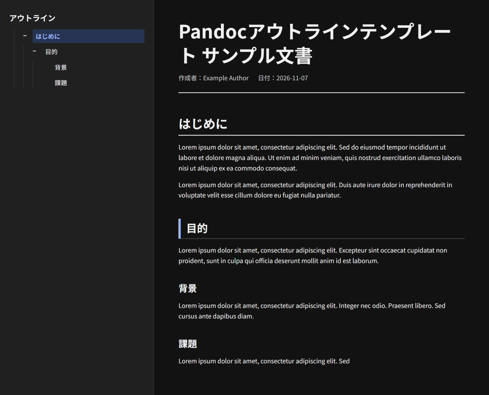

# Pandoc HTMLテンプレート

MarkdownをPandocでHTMLに変換する際に利用するテンプレートです。見やすく、使いやすいレイアウトと機能を実装しました。



## 特徴
- 自動生成されるサイドバー型アウトライン
- 見出し階層の折り畳み・展開
- ダークモード対応

## 利用方法
```shell
pandoc input.md --template=template.html -o output.html
```


## ライセンス
MIT License